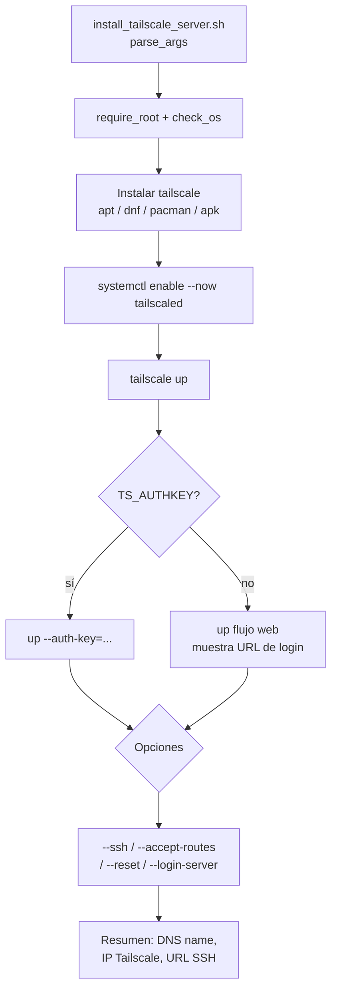

# auto-tailscale

Instalador one-shot de Tailscale para Linux en Bash: instala el paquete del gestor de la distribución, habilita el servicio `tailscaled`, autentica con auth key o flujo web, y opcionalmente habilita Tailscale SSH y aceptación de rutas.

[](LICENSE)
[](https://github.com/bi0punk/auto-tailscale/actions/workflows/ci.yml)

## Contenido

- [Características](#características)
- [Arquitectura](#arquitectura)
- [Stack](#stack)
- [Estructura del repositorio](#estructura-del-repositorio)
- [Instalación](#instalación)
- [Uso](#uso)
- [Configuración](#configuración)
- [Tests / CI](#tests--ci)
- [Roadmap](#roadmap)
- [Licencia](#licencia)

## Características

- Soporte multi-distribución (apt, dnf, pacman, apk).
- Autenticación por auth key (`TS_AUTHKEY`) o flujo web interactivo.
- Habilitación opcional de Tailscale SSH (`--ssh`).
- Aceptación de rutas (`--accept-routes`).
- Flag `--reset` para reconexión limpia (`tailscale up --reset`).
- Hostname y login server configurables por variables de entorno.
- Logging completo con timestamps y resumen final (URL SSH, IP, admin).

## Arquitectura



## Stack

- Bash (`set -Eeuo pipefail`)
- Tailscale CLI (`tailscale`, `tailscaled`)

## Estructura del repositorio

```
auto-tailscale/
├── install_tailscale_server.sh   # Script principal
├── .github/workflows/ci.yml
└── LICENSE
```

## Instalación

Requisitos: Linux (Debian, Ubuntu, Fedora, Arch, Alpine, etc.), acceso root (sudo) y conexión a internet.

```bash
git clone https://github.com/bi0punk/auto-tailscale.git
cd auto-tailscale
```

## Uso

```bash
# Instalar con autenticación web
sudo bash install_tailscale_server.sh

# Instalar con auth key (variable de entorno)
sudo TS_AUTHKEY=tskey-xxxx bash install_tailscale_server.sh

# Con hostname y login server personalizado
sudo TS_HOSTNAME=servidor-atacama TS_LOGIN_SERVER=https://headscale.ejemplo bash install_tailscale_server.sh

# Con SSH y aceptación de rutas
sudo bash install_tailscale_server.sh --ssh --accept-routes

# Reconfigurar (reconexión limpia)
sudo bash install_tailscale_server.sh --reset

# Ayuda
sudo bash install_tailscale_server.sh --help
```

## Configuración

Variables de entorno:

| Variable | Default | Descripción |
|---|---|---|
| `TS_AUTHKEY` | *(vacío)* | Auth key de Tailscale para alta automática |
| `TS_HOSTNAME` | `$(hostname -s)` | Nombre deseado del nodo en Tailscale |
| `TS_LOGIN_SERVER` | *(vacío)* | Control server (por defecto, Tailscale SaaS) |

Flags: `--ssh`, `--accept-routes`, `--reset`, `-h|--help`. El log de instalación se guarda en `/tmp/tailscale_setup_YYYYMMDD_HHMMSS.log`.

## Tests / CI

No hay suite de tests local. CI: GitHub Actions (`.github/workflows/ci.yml`) ejecuta ShellCheck (`shellcheck *.sh`) sobre Ubuntu latest en cada push y PR.

## Roadmap

- [x] Instalación multi-distribución + alta automática o web
- [x] Soporte SSH y `--accept-routes`
- [ ] Soporte para macOS
- [ ] Integración con systemd para auto-arranque
- [ ] Modo headless sin prompts interactivos
- [ ] Tests de integración en contenedores

## Licencia

MIT — ver [LICENSE](LICENSE).